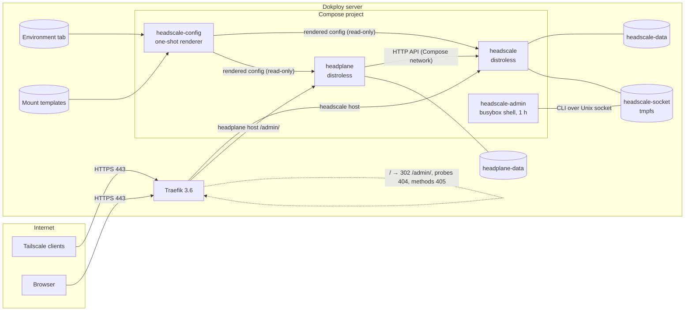

# Headscale + Headplane for Dokploy

A [Dokploy](https://dokploy.com) template that deploys a self-hosted
[Tailscale](https://tailscale.com) control server, [Headscale](https://headscale.net),
together with its web UI, [Headplane](https://headplane.net), as one Compose service.

| Component | Version | Image |
| --- | --- | --- |
| Headscale | 0.29.5 | `docker.io/headscale/headscale:0.29.5` |
| Headplane | 0.8.1 | `ghcr.io/tale/headplane:0.8.1` |
| Config renderer and admin shell | 0.29.5 | `docker.io/headscale/headscale:0.29.5-debug` |
| Dokploy | v0.30.x (verified against the v0.30.8 source) | Traefik 3.6.25 |

After a deployment you have:

- `https://headscale.<your-domain>`: the control server your Tailscale clients log in to
- `https://headplane.<your-domain>/admin/`: the web UI for users, machines, pre-auth keys and ACLs
- `*.vpn.<your-domain>`: MagicDNS names, resolved inside the tailnet (no DNS record needed)

## Status

| | Feature |
| --- | --- |
| **Validated on a live Dokploy** (template `5bca341`) | Base64 import, both services healthy, Let's Encrypt HTTPS, first API key created in Dokploy's web terminal (no SSH), Headplane login, client registration |
| **Tested automatically, not yet on a live Dokploy** | Everything new in this version: installation from the Templates catalog, Environment-driven configuration, `/` → `/admin/` redirect and 404/405 filtering in Traefik, Isolated Deployment, upgrading an existing deployment by re-import, migrating a Headscale-only installation |
| Automated test coverage | Real containers behind Dokploy's Traefik version and labels, shared and isolated networks, real Tailscale clients over HTTPS: **62 routing checks × 2 network modes, 95 end-to-end checks**, plus static and upstream validation (see [Testing](#testing)) |

## Contents

- [Quick start](#quick-start)
- [Architecture](#architecture)
- [Configuration](#configuration)
- [DNS](#dns)
- [HTTPS](#https)
- [First login without SSH](#first-login-without-ssh)
- [How Headplane is routed](#how-headplane-is-routed)
- [Connecting Tailscale clients](#connecting-tailscale-clients)
- [Pre-authentication keys](#pre-authentication-keys)
- [Security](#security)
- [Backup and restore](#backup-and-restore)
- [Upgrading](#upgrading)
- [Troubleshooting](#troubleshooting)
- [Differences from the upstream Docker examples](#differences-from-the-upstream-docker-examples)
- [Testing](#testing)
- [Contributing and license](#contributing-and-license)

## Quick start

### 1. DNS

Point two names at your Dokploy server. The Headscale record must be **DNS only**
(see [DNS](#dns)):

| Name | Type | Value |
| --- | --- | --- |
| `headscale.example.com` | A / AAAA | server IP |
| `headplane.example.com` | A / AAAA | server IP |

### 2. Install the template

**From Dokploy's Templates catalog** (recommended):

1. Project → **Create Service → Template**. Enter this repository as **Base URL**:
   `https://raw.githubusercontent.com/BogdanGorelkin/dokploy-headscale-headplane/<tag-or-commit>`
   (the repository must be public; until the template is accepted into the official catalog).
2. Search for **Headscale + Headplane** → **Create**. Dokploy creates the service but does not
   deploy it yet.

**Or by Base64 import:** create an empty Compose service, open **Advanced → Import** and paste
`import-base64.txt` from a [release](../../releases). To bake in your domain, build it
yourself: `npm ci && npm run build:import -- --base-domain example.com`.

### 3. Configure before the first deploy

1. **Advanced → Enable Isolated Deployment.** Required if another stack on the server has a
   service named `headscale`, and recommended otherwise.
2. **Environment:** set your host names (the template starts with generated `*.sslip.io`
   names):

   ```
   HEADSCALE_HOST=headscale.example.com
   HEADPLANE_HOST=headplane.example.com
   MAGICDNS_DOMAIN=vpn.example.com
   HEADPLANE_COOKIE_SECRET=<leave as generated>
   ```

3. **Domains:** edit both domains to the same hosts as above. Keep the Headplane path
   `/admin/`, and set **Certificate Provider: Let's Encrypt**.

### 4. Deploy

**Deploy**. Under **Containers**, `headscale-config` runs and exits (0), then `headscale`,
`headplane` and `headscale-admin` become *healthy*.

```bash
curl -fsS https://headscale.example.com/health   # {"status":"pass"}
```

### 5. First login

**Containers → headscale-admin → ⋯ → Terminal → /bin/sh tab**, then run:

```sh
headscale apikeys create --expiration 90d
```

Paste the key at `https://headplane.example.com/admin/`. See [First login without SSH](#first-login-without-ssh).

## Architecture



| Service | Runs | Purpose |
| --- | --- | --- |
| `headscale-config` | Once per deploy, then exits 0 | Validates the Environment and renders both config files from the mount templates |
| `headscale` | Always | Control server (distroless, read-only) |
| `headplane` | Always | Web UI under `/admin/` (distroless, read-only) |
| `headscale-admin` | Up to 1 hour per deploy or Start | Shell for creating API keys from Dokploy's terminal |

| Volume | Contents |
| --- | --- |
| `headscale-data` | `db.sqlite` (+ WAL), `noise_private.key`: all state and the server identity |
| `headplane-data` | Headplane database (sessions, roles) |
| `headscale-config`, `headplane-config` | Rendered configuration, re-created on every deploy |
| `headscale-socket` | Headscale's admin socket on tmpfs, shared only with `headscale-admin` |

No host ports are published. Headscale's metrics (`:9090`) and gRPC (`:50443`) listen only on
the container loopback. There is no Docker socket, no agent and no privileged mode. Every
container runs read-only with `cap_drop: ALL` and `no-new-privileges`.

## Configuration

### Environment (the single place for instance-specific values)

| Variable | Set by the template to | Used for |
| --- | --- | --- |
| `HEADSCALE_HOST` | `headscale.<base>` | `server_url`, Headplane's `public_url` |
| `HEADPLANE_HOST` | `headplane.<base>` | Headplane `base_url`, the `/` redirect and filter routers |
| `MAGICDNS_DOMAIN` | `vpn.<base>` | `dns.base_domain` (MagicDNS suffix). Must not equal, or be a parent of, `HEADSCALE_HOST` |
| `HEADPLANE_COOKIE_SECRET` | 32 random hex characters (`${hash:32}`) | Headplane session encryption |

`<base>` is `${domain}` in the catalog, which Dokploy turns into
`<project>-<hash>-<server-ip>.sslip.io`. That name resolves to your server with no DNS setup,
which is enough for a first test.

**Changing values later:** edit the Environment (and the two Domains, if a host changes), then
**Deploy**. `headscale-config` re-renders both files, and Compose restarts `headscale` and
`headplane` (`depends_on … restart: true`). A redeploy without changes restarts nothing.

**Invalid values** (for example an uppercase or malformed host name) make `headscale-config`
fail with a clear message such as `error: HEADSCALE_HOST is invalid (expected a lowercase DNS
name)`, and the deploy fails. Compose has already stopped the dependent services at that point,
so the control plane stays down until the value is fixed and redeployed. Connected clients keep
their existing peer-to-peer connections in the meantime.

### Mount templates (everything else)

**Advanced → Mounts** holds two templates, rendered on every deploy:

- `/templates/headscale.yaml`: the full [Headscale 0.29.5 configuration](https://github.com/juanfont/headscale/blob/v0.29.5/config-example.yaml)
- `/templates/headplane.yaml`: the [Headplane 0.8.1 configuration](https://github.com/tale/headplane/blob/v0.8.1/config.example.yaml)

`{{HEADSCALE_HOST}}`-style placeholders are filled in from the Environment. An unknown
placeholder fails the deploy. **After editing a template, Deploy and then Restart `headscale`
and/or `headplane`** under **Containers**: the template text isn't part of the Compose
definition, so a deploy re-renders the file without restarting the services.

Notable defaults:

- `policy.mode: database`. ACLs are edited in Headplane's **Access Control** page. Until a
  policy is saved, **all nodes can reach each other**.
- DERP: Tailscale's public relays. The embedded DERP needs UDP/3478 on the host, which this
  template doesn't publish.
- MagicDNS on; resolvers 1.1.1.1 / 1.0.0.1 (+ IPv6); `override_local_dns: true`.
- `trusted_proxies`: the RFC 1918 ranges, so Headscale logs real client IPs from Traefik.
- Headplane reads the Headscale config **read-only**. It displays DNS settings but can't change
  them; edit the template instead.

## DNS

Dokploy does not create DNS records.

| Name | Requirement |
| --- | --- |
| Headscale host | **DNS only.** Cloudflare's proxy ("orange cloud") and Cloudflare Tunnel can't carry the Tailscale control protocol, a WebSocket upgrade over `POST` ([Headscale docs](https://headscale.net/stable/ref/integration/reverse-proxy/#cloudflare)). It needs a publicly trusted certificate: Cloudflare *Origin* certificates are rejected by Tailscale clients |
| Headplane host | Plain DNS recommended. Proxying through a CDN works, as it is ordinary HTTPS |
| MagicDNS domain | **No record.** Resolved inside the tailnet |

```bash
dig +short headscale.example.com   # must be the server IP, not a CDN address
```

## HTTPS

TLS is terminated by Dokploy's Traefik. Dokploy creates the template's domains with HTTPS on
and *Certificate Provider: None*, whatever the template says. Set **Let's Encrypt** on both
domains (HTTP-01: DNS must point at the server and TCP 80 must be reachable), or rely on a
certificate already loaded into Traefik that covers the host (for example a wildcard). Redeploy
after changing domain settings.

Until a valid certificate is served, browsers warn, Tailscale clients refuse to connect, and
Headplane login fails because its session cookie is `Secure`.

## First login without SSH

Headplane signs you in with a **Headscale API key**. The production images are distroless and
have no shell, so the template adds **`headscale-admin`**. It runs the official
`headscale:<same version>-debug` image, which is the same Headscale build plus busybox.

1. **Containers → `headscale-admin`**. If it shows *exited*, its one-hour idle timeout passed:
   **⋯ → Start**.
2. **⋯ → Terminal → /bin/sh** tab. The *Bash* tab fails: the image has no bash.
3. Run `headscale apikeys create --expiration 90d`, copy the `hskey-api-…` value, and sign in at
   `https://<HEADPLANE_HOST>/admin/`.

The key is printed **only in your terminal session**: Dokploy streams terminal output to the
browser without storing it, the helper writes nothing to its logs, and Headscale stores only a
hash. The same shell manages keys later (`headscale apikeys list`,
`headscale apikeys expire --prefix <prefix>`) and runs any other `headscale` command.

How the helper is contained:

- **No database access.** The CLI asks the running server to act, through its Unix socket; the
  helper doesn't mount `headscale-data`, so SQLite is never opened twice.
- **The socket lives on tmpfs** (`headscale-socket`) and is shared only with `headscale`;
  Headplane doesn't get it. Compose scopes the volume to this project.
- No ports, no listeners, no Docker socket. Read-only, `cap_drop: ALL`, no restart policy: after
  an hour it exits and stays stopped until you Start it or redeploy.
- While it runs, anyone who can open this service's terminal in Dokploy can create admin keys.
  Dokploy users with that access can already redeploy the service with any configuration, so
  this grants no new privilege.

| Alternative | Why not |
| --- | --- |
| Terminal into `headscale` | Distroless: no shell |
| `-debug` image for production `headscale` | Permanent shell in the internet-facing container |
| One-shot container that prints a key | Key in container logs |
| Key stored in a volume or env var | Key at rest, and reading it still needs the host |
| Dokploy Schedules | Runs `sh -c` in the target container, and output is kept in schedule logs |
| Headplane proxy auth, bootstrap web endpoint, Docker socket | Trusts the shared network, exposes an endpoint, or grants root |

**SSH fallback** (Dokploy role without terminal access): on the Docker host,
`./scripts/create-api-key.sh` lists Headscale deployments, and
`./scripts/create-api-key.sh <app-name> 90d` creates a key.

## How Headplane is routed

Headplane serves everything under `/admin/`; its server answers every other path with a React
Router error and a stack trace in the logs. The template therefore routes only `/admin/` to it,
and Traefik answers the rest:

| Request | Answer | Reaches Headplane |
| --- | --- | --- |
| `GET /`, `GET /admin` (query string kept) | **302** → `https://<host>/admin/` | no |
| `HEAD /`, `HEAD /admin` | **307** → `/admin/` (Traefik's redirect middleware answers non-GET methods with 307; for HEAD it is equivalent to 302) | no |
| `http://…/` | **302** → `https://<host>/admin/` (one hop) | no |
| Any other path outside `/admin/` (`/favicon.ico`, `/xmlrpc.php`, `/.env`, …) and any method on `/` other than GET/HEAD | **404** | no |
| `/admin/…` dot-files and `.php`/`.asp(x)`/`.jsp`/`.cgi` probes | **404** | no |
| `/admin/…` with a method the UI never sends (anything but GET, HEAD, POST, PATCH) | **405** | no |
| Everything else under `/admin/` (pages, assets, login, ACL editor's `PATCH`, SSE) | forwarded | yes |

The routers and middlewares are labels on the `headplane` service, named
`<app-name>-headplane-*`. They never reference Dokploy's generated router names, and they work
in shared and isolated network mode. The 404/405 answers come from Traefik's `noop@internal`
service, rewritten by an `errors` middleware. Other unknown paths under `/admin/` (for example
`/admin/debug/x`) still reach Headplane and are logged by it; Headplane's route table isn't
duplicated into Traefik, to avoid breaking new Headplane pages after an upgrade.

## Connecting Tailscale clients

```bash
sudo tailscale up --login-server https://headscale.example.com --authkey <pre-auth-key>
# or interactively; register the printed key in Headplane: Machines → Add Device → Register Machine Key
sudo tailscale up --login-server https://headscale.example.com
```

GUI clients (Windows, macOS, iOS, Android): set a custom control server URL following
[Headscale's client docs](https://headscale.net/stable/usage/getting-started/).

## Pre-authentication keys

Headplane: **Users** → create a user, then **Settings → Manage Auth Keys → Create pre-auth key**
(also **Machines → Add Device → Generate Pre-auth Key**). Choose *Reusable* to enrol several
machines, and *Ephemeral* for short-lived ones (removed after 30 minutes offline). Keep
expirations short. The key is shown once. CLI equivalent in the admin shell:
`headscale preauthkeys create --user <id> --reusable --expiration 24h`.

## Security

- **Authentication:** Headplane requires a valid, unexpired Headscale API key (or OIDC, if you
  configure it). Sessions last at most 24 hours and never longer than the key remains valid.
- **Headscale's REST API is public** on the Headscale host (as in every standard deployment) and
  accepts only API keys. Keep keys short-lived and expire unused ones.
- **Default policy allows all traffic.** Save an ACL policy before adding devices that shouldn't
  reach each other.
- **Secrets:** the cookie secret lives in the Environment tab (Dokploy's database) and in the
  rendered `headplane-config` volume, not in Git or in logs. The import string and the catalog
  contain no secrets; Dokploy generates them on the server.
- **Admin helper:** see [First login without SSH](#first-login-without-ssh). Stop it after use if
  you prefer; it stops itself within an hour.
- **Isolation:** enable *Isolated Deployment*. Otherwise Dokploy's shared `dokploy-network` lets
  another stack's service named `headscale` shadow ours.
- **Containers:** read-only root filesystems, `cap_drop: ALL`, `no-new-privileges`, no host
  ports, no Docker socket, metrics and gRPC on loopback only.
- **Request filtering:** junk paths and unexpected methods are answered by Traefik and never
  reach Headplane (see [routing](#how-headplane-is-routed)).
- **`trusted_proxies`** trusts private ranges because Traefik reaches Headscale over Docker
  networks. A container on those networks could therefore fake the client IP that Headscale
  logs; this doesn't affect authentication.
- Reporting vulnerabilities: see [SECURITY.md](SECURITY.md).

## Backup and restore

`headscale-data` is what matters: the database and `noise_private.key` (the server identity).
Losing the key forces every client to re-register.

```bash
./scripts/backup.sh <app-name> /root/backups/headscale-$(date +%F)
./scripts/restore.sh <app-name> /root/backups/headscale-2026-10-22   # asks for confirmation
```

- `backup.sh` stops both services for a few seconds (consistent SQLite + WAL), archives
  `headscale-data`, `headplane-data` and the Dokploy mount templates, and writes a `MANIFEST`
  with SHA-256 checksums.
- `restore.sh` replaces the volumes found in the backup; `headplane-data` is optional. The target
  must have been deployed once, so its volumes exist.
- Both scripts run on the Docker host (SSH). The backup contains private keys: store it encrypted.
- Dokploy's *Volume Backups* can also back up `headscale-data` to S3. Stop the services during
  the backup for a consistent copy.

Migrating from another Headscale installation: see [docs/MIGRATION-HABS.md](docs/MIGRATION-HABS.md)
for a staged, reversible procedure.

## Upgrading

1. Read the [Headscale](https://github.com/juanfont/headscale/releases) and
   [Headplane](https://github.com/tale/headplane/releases) release notes. Headscale must be
   upgraded **one minor version at a time**.
2. Back up.
3. Either install the new template version over the existing service (**Advanced → Import**
   with the new release's string), or edit the image tags in **General**. Keep `headscale-config`
   and `headscale-admin` on the same version as `headscale`, with the `-debug` suffix.
4. **Deploy**, then check that all services are healthy and `headscale nodes list` shows your
   machines.

**Re-importing** replaces the compose file, Environment, mounts and domains and keeps the
volumes. Afterwards, set your host names in the Environment and Domains again, and choose Let's
Encrypt again. A new cookie secret is generated, so everyone signs in again.

**From earlier versions of this template** (configuration in `/etc/headscale/config.yaml`
mounts, no `headscale-config` service): re-import as above. The end-to-end test covers exactly
this upgrade, from `5bca341`.

## Troubleshooting

| Symptom | Cause and fix |
| --- | --- |
| Deploy fails: `service "headscale-config" didn't complete successfully` | An Environment value is invalid. Check **Containers → headscale-config → Logs**, fix it, redeploy |
| Headplane login returns to the login page | Headplane isn't served over valid HTTPS (Secure cookie). Set Let's Encrypt on the domain and redeploy |
| Browser shows "TRAEFIK DEFAULT CERT" | Certificate not issued yet: check DNS, port 80, *Certificate Provider* |
| `tailscale up` hangs or reports TLS errors | Same as above, or the Headscale record is proxied by Cloudflare |
| `https://<headplane>/` doesn't redirect | `HEADPLANE_HOST` differs from the Headplane domain host; keep them equal |
| 404 on every Headplane page | The Headplane domain path isn't `/admin/` |
| Headplane shows wrong data or can't connect | Possibly another `headscale` service on `dokploy-network`: enable Isolated Deployment |
| A mount template edit has no effect | Deploy, then Restart `headscale`/`headplane` |
| Terminal: `executable file not found` | You picked the *Bash* tab; use **/bin/sh** |
| `headscale-admin` is *exited* | Idle timeout reached: **⋯ → Start** |
| No shell on `headscale` / `headplane` | Expected (distroless); use `headscale-admin` |

## Differences from the upstream Docker examples

| Topic | Upstream examples | This template |
| --- | --- | --- |
| Configuration | Hand-edited files | Environment tab + rendered templates, validated on every deploy |
| Ports | Published `8080`, `9090`, `3000` | `expose` only; Traefik routes |
| Images | `<VERSION>`, `headplane:latest` | Exact pins (Headplane 0.8.0 broke actions behind TLS proxies) |
| Headplane ↔ Headscale | Shared writable config, Docker socket | Read-only config, no socket |
| Headplane routing | `/admin` on the Headscale host, CORS middleware | Own host, only `/admin/` forwarded, root redirect, 404/405 filtering |
| CLI access | `docker exec` on the host | `headscale-admin` shell in Dokploy's terminal |
| ACLs | File or database | `policy.mode: database`, editable in Headplane |
| Hardening | `read_only` for Headscale | `read_only`, `cap_drop: ALL`, `no-new-privileges` everywhere |
| Embedded DERP | Optional | Disabled (would need UDP/3478) |

## Testing

| Layer | Command | Covers |
| --- | --- | --- |
| Static | `npm run validate` | YAML/TOML/meta, Dokploy conventions, Compose variables, template placeholders, generated configs, label safety, secrets |
| Negative | `npm run test:negative` | 29 broken variants rejected (helper, renderer, labels, domains, secrets…) |
| Catalog | `npm run check:catalog` | Installs from this checkout served as a template catalog, using Dokploy's fetch and deploy logic |
| Upstream | `scripts/check-upstream.sh <Dokploy/templates checkout>` | The official Dokploy/templates validators |
| Routing | `npm run test:routing` | Real Traefik 3.6.25 wired like Dokploy, shared and isolated networks: redirects, no loops, 404/405, assets, login, cookies, users, pre-auth keys, ACL `PATCH`, Headscale API, Tailscale over HTTPS (62 checks per mode) |
| End-to-end | `npm run test:e2e` | Upgrade by re-import from `5bca341`, helper bootstrap, Environment changes, invalid values, template edits, restart, recreate, fresh install, backup/restore, Headscale-only migration, clients reconnecting without re-registration (95 checks) |
| Live Dokploy | [docs/TESTING.md](docs/TESTING.md) | Catalog install, Let's Encrypt, real devices |

All automated layers run in CI. Tests use `scripts/lib/dokploy.mjs` and
`scripts/lib/dokploy-deploy.mjs`, ports of Dokploy's template processor and deploy-time
labelling, so they exercise exactly what Dokploy generates.

## Contributing and license

See [CONTRIBUTING.md](CONTRIBUTING.md) and [CHANGELOG.md](CHANGELOG.md). Licensed under the
[MIT License](LICENSE); two tooling files derived from Dokploy are Apache-2.0, see
[THIRD_PARTY_NOTICES.md](THIRD_PARTY_NOTICES.md).
